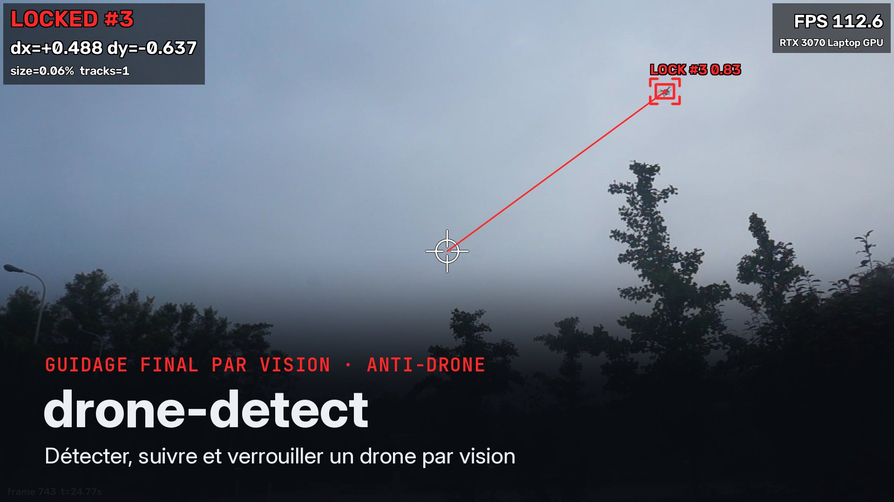
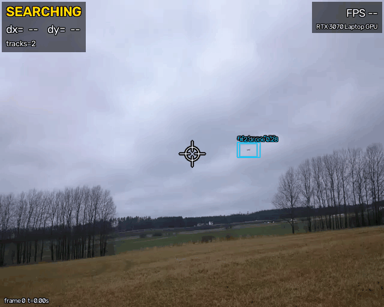
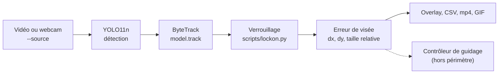
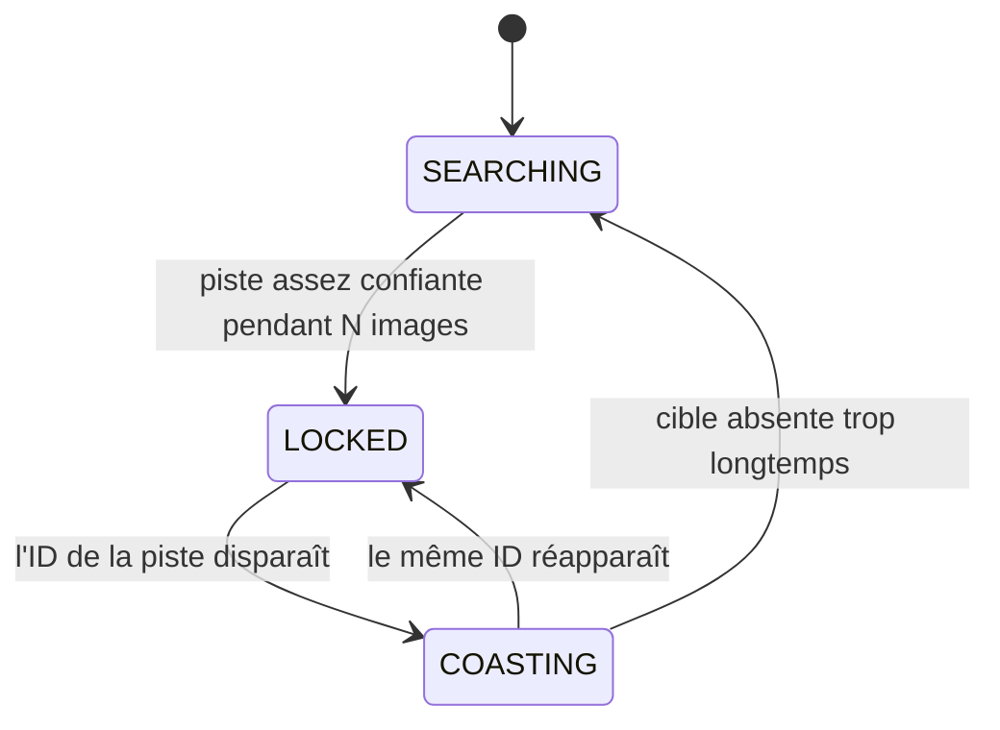
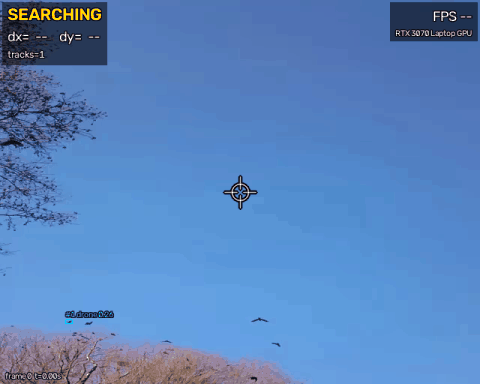

# drone-detect : détection, suivi et verrouillage de drones par vision

Un détecteur YOLO11n fine-tuné sur des drones, suivi par ByteTrack. Une logique de
verrouillage produit, image par image, l'erreur de visée de la cible.

<!-- TODO après upload : remplacer par l'URL user-attachments -->
<p align="center">
  <a href="docs/assets/presentation.mp4">
    
  </a>
  <br><em>Vidéo de présentation : cliquer sur l'image.</em>
</p>

<p align="center">
  
  <br><em>Séquence de test jamais vue à l'entraînement (Halmstad V_DRONE_035, 640×512) : le drone
  est verrouillé (LOCKED #id) et son erreur de visée dx/dy s'affiche. Modèle R2 en TensorRT FP16
  à 1280 px, RTX 3070 Laptop.</em>
</p>

| Chiffre clé (modèle R2, inférence à 1280 px) | Valeur |
|---|---|
| mAP50 / mAP50-95 sur le test (2 326 images, 49 séquences jamais vues) | 0,781 / 0,265 |
| Drones trouvés à IoU 0,3 : rappel / précision | 0,95 / 0,91 |
| Boucle complète (lecture + détection + suivi + verrouillage), vidéo 1080p, TensorRT FP16 | 106 FPS |
| Réseau seul, TensorRT FP16 | 391 FPS (2,6 ms) |

À IoU 0,3, une détection compte dès qu'elle désigne le bon drone, même avec une boîte mal
ajustée. C'est ce qui importe pour la visée, qui n'utilise que le centre de la boîte (à IoU 0,5 :
rappel 0,81). Les FPS sont mesurés sur un PC portable (RTX 3070 Laptop 8 Go, Ryzen 7 5800H),
pas sur Jetson. Détails : [`docs/RESULTS.md`](docs/RESULTS.md) (précision) et
[`docs/EXPORT.md`](docs/EXPORT.md) (vitesse).

## Objectif

Cible visée : le guidage final, par vision, d'un drone intercepteur. Dans cette phase, la
caméra de l'intercepteur doit trouver la cible, la garder et mesurer de combien elle s'écarte
du centre de l'image.

Ce dépôt fournit cette brique de perception. Pour chaque image d'une vidéo :

1. il détecte les drones (YOLO11n, une classe `drone`) ;
2. il les suit d'une image à l'autre (ByteTrack) ;
3. il verrouille une cible et la garde tant que le suivi tient ;
4. il calcule l'erreur de visée normalisée **(dx, dy)** entre le centre de l'image et la
   cible, plus la taille relative de la cible (indice de distance).

Ces valeurs sont écrites à l'écran et dans un CSV, une ligne par image. C'est l'entrée
qu'un contrôleur de guidage terminal consommerait.

**Le dépôt s'arrête là. Il ne contient aucun code de contrôle de vol, de pilotage ni de
charge utile.**

## Démarrage rapide

### Installation

Testé sous Linux, Python 3.12, avec [uv](https://docs.astral.sh/uv/).

<!-- TODO : URL définitive du dépôt (pseudo GitHub) -->
```bash
git clone https://github.com/<pseudo>/drone-detect.git
cd drone-detect
uv venv --python 3.12
uv pip install -r requirements.txt
```

`requirements.txt` fixe les versions utilisées (torch 2.14 + CUDA 13, Ultralytics 8.4.190).
Avec un pilote NVIDIA plus ancien, installer d'abord la version de torch adaptée à son CUDA.
`ffmpeg` (libx264) sert aux vidéos de démo et aux mp4 H.264. Les scripts gardent les réglages
Ultralytics dans `.ultralytics/`, à la racine du dépôt, sans toucher à la configuration
globale.

### Poids

Les poids fine-tunés sont publiés dans une GitHub Release, pas dans le dépôt :
[v1.0](https://github.com/nathanpetitboulanger/drone-detect/releases/tag/v1.0). Les placer dans `weights/` (ignoré par git).

| Fichiers | Modèle | `--imgsz` |
|---|---|---|
| `drone_yolo11n_1280.pt`, `drone_yolo11n_1280.onnx` | R2, modèle de la démo | 1280 |
| `drone_yolo11n_640.pt`, `drone_yolo11n_640.onnx` | R1, plus léger | 640 |

La Release fournit aussi `SHA256SUMS`. Pour vérifier les fichiers téléchargés :
`cd weights && sha256sum -c --ignore-missing SHA256SUMS`.

L'engine TensorRT n'est pas publié : il dépend du GPU et de la version de TensorRT qui l'ont
construit. On le reconstruit sur la machine cible :

```bash
.venv/bin/python scripts/export.py --weights weights/drone_yolo11n_1280.pt --imgsz 1280 \
    --formats engine --device 0       # → weights/drone_yolo11n_1280_1280_fp16.engine
```

### Lancer la démo

```bash
# Sur n'importe quelle vidéo (fichier ou URL), réglages des GIF de ce README
.venv/bin/python scripts/demo.py --weights weights/drone_yolo11n_1280.pt --imgsz 1280 \
    --lock-conf 0.4 --source ma_video.mp4 --save outputs/demo/ma_video.mp4 \
    --csv outputs/demo/ma_video.csv --gif outputs/demo/ma_video.gif

# Webcam, avec fenêtre (q ou Échap pour quitter)
.venv/bin/python scripts/demo.py --weights weights/drone_yolo11n_1280.pt --imgsz 1280 --source 0 --show
```

Toujours passer le `--imgsz` d'entraînement du modèle (tableau ci-dessus). À une autre taille,
le même modèle perd jusqu'à 26 points de mAP50 (voir [Résultats](#entraînement-et-évaluation)).
Les poids `.onnx` et `.engine` fonctionnent aussi ; les GIF ont été produits avec l'engine
TensorRT.

Sorties, toutes optionnelles :

- `--save` : vidéo annotée (mp4) ;
- `--csv` : une ligne par image, avec l'état du verrou et l'erreur de visée ;
- `--gif` : GIF réduit pour un README ou un message (8 Mo visés).

Sans poids drones, la démo tourne avec le modèle COCO (`yolo11n.pt`, téléchargé
automatiquement). Un drone y sort souvent en `airplane`, `bird` ou `kite` :

```bash
.venv/bin/python scripts/demo.py --source ma_video.mp4 --classes airplane bird kite --lock-conf 0.25
```

`scripts/demo.py --help` liste toutes les options : tracker, seuils, durée du
« coasting »…

## Fonctionnement de la démo



**Détection et suivi.** `scripts/demo.py` lit la vidéo image par image et appelle
`model.track(frame, persist=True)` d'Ultralytics. Le tracker par défaut est ByteTrack ;
BoT-SORT est disponible avec `--tracker botsort.yaml`. Le seuil du détecteur est bas
(`--conf 0.1`), car ByteTrack exploite aussi les détections faibles pour garder les pistes.

**Verrouillage.** `scripts/lockon.py` est du Python pur, sans OpenCV ni Ultralytics, et il est
couvert par des tests unitaires (`tests/test_lockon.py`). C'est une machine à trois états :



- **Acquisition** : la piste la plus confiante, si sa confiance dépasse `--lock-conf` (0,5)
  depuis au moins `--lock-min-frames` images consécutives (3). Ce délai évite de verrouiller
  un faux positif fugace.
- **Maintien** : le verrou reste sur la même piste tant que son ID existe, même si une autre
  piste devient plus confiante. On ne saute pas d'une cible à l'autre.
- **Coasting** : si la piste disparaît, on garde sa dernière position pendant
  `--coast-frames` images (15), puis on relâche. En option, `--reacquire-radius` reprend une
  piste proche de la dernière position, utile quand le tracker change d'ID.

**Erreur de visée.** Pour une image de largeur W et de hauteur H, et une cible de centre
(cx, cy) en pixels :

```
dx = (cx − W/2) / (W/2)      dy = (cy − H/2) / (H/2)      bornés à [−1, 1]
```

`dx > 0` : cible à droite du centre. `dy > 0` : cible en bas (axe image vers le bas).
`(0, 0)` : cible sur le réticule. La taille relative `box_area_ratio = (w·h) / (W·H)` grandit
quand la cible se rapproche. Ce sont des unités d'image : les convertir en angles demande la
calibration de la caméra (champ de vision).

**CSV** (`--csv`, une ligne par image) :

| Colonne | Contenu |
|---|---|
| `frame`, `t_s` | index de l'image ; horodatage en s (fichier : index / fps source ; webcam : temps écoulé) |
| `fps` | FPS de la boucle à cette image (moyenne glissante) |
| `state` | `SEARCHING`, `LOCKED` ou `COASTING` |
| `track_id`, `conf` | ID de la piste verrouillée, confiance de sa détection |
| `cx`, `cy`, `w`, `h` | centre et taille de la boîte, en pixels |
| `dx`, `dy` | erreur de visée normalisée, voir ci-dessus |
| `box_area_ratio` | aire de la boîte / aire de l'image |
| `n_tracks` | nombre de pistes confirmées dans l'image |

Les colonnes de la cible sont vides en `SEARCHING`. En `COASTING`, elles répètent la dernière
observation : la donnée est périmée et doit être traitée comme telle.

**FPS.** Le FPS affiché est celui de la boucle complète : lecture de l'image, inférence,
suivi et verrouillage. C'est la cadence à laquelle un contrôleur recevrait une nouvelle
erreur de visée. À la fin, le script affiche aussi le débit global, écritures comprises, et
le matériel utilisé. Les mesures de référence sont dans
[Export et performances](#export-et-performances).

## Données

Résumé de [`docs/DATA.md`](docs/DATA.md), qui détaille sources, licences, conversion,
découpage et statistiques.

| Source | Licence | Rôle |
|---|---|---|
| [Halmstad Drone-detection-dataset](https://github.com/DroneDetectionThesis/Drone-detection-dataset) (Svanström et al.), vidéos visibles 640×512 | CC0-1.0 | 114 vidéos de drones, plus 170 vidéos d'oiseaux, d'avions et d'hélicoptères (négatifs difficiles) |
| [DUT Anti-UAV](https://github.com/wangdongdut/DUT-Anti-UAV), partie tracking (Zhao et al.), 720p et 1080p | Apache-2.0 | 20 séquences, découpées comme les autres |
| DUT Anti-UAV, partie détection | Apache-2.0 | 10 000 images, **en train seulement** |

- Environ 5,3 Go à télécharger, sans compte ni clé API. Les données ne sont ni versionnées ni
  redistribuées : chacun les télécharge à la source avec `scripts/data/download.py`.
- Une seule classe, `drone`, au format YOLO. Oiseaux, avions et hélicoptères restent sans
  label : le modèle doit apprendre à les ignorer.
- **Découpage par séquence, jamais par image.** Des images voisines d'une même vidéo sont
  presque identiques. Les mélanger entre train et test gonflerait les scores. Les clips
  proches (même vol, même décor) sont regroupés avant le tirage, et
  `scripts/data/split.py --check` vérifie qu'aucune séquence n'apparaît dans deux splits.
- **Pourquoi DUT détection sert en train seulement.** Ses images sont des frames de vidéos,
  sans identifiant de séquence, et son découpage officiel fuit : 65 % des images de son test
  ont une quasi-copie dans son train. Certaines viennent aussi des mêmes décors que les
  séquences DUT tracking. Les 332 images qui ressemblent à une séquence val ou test sont donc
  écartées ; les autres vont en train.
- Taille : **19 495 / 1 824 / 2 326 images** (train / val / test). Le test contient
  1 982 drones, dont 40 % mesurent moins de 32 px (côté équivalent √(w·h)).
- Quatre séquences du test, jamais vues à l'entraînement, servent à la démo. L'une ne montre
  que des oiseaux, pour juger les fausses alarmes.

Reproduire le jeu de données (sur la machine de dev : ~10 min de téléchargement, quelques
minutes de conversion) :

```bash
.venv/bin/python scripts/data/download.py            # ~5,3 Go → data/raw/
.venv/bin/python scripts/data/convert_halmstad.py
.venv/bin/python scripts/data/convert_dut_track.py
.venv/bin/python scripts/data/convert_dut_det.py     # après dut_track
.venv/bin/python scripts/data/split.py               # train/val/test par séquence + vérification
.venv/bin/python scripts/data/stats.py               # statistiques → data/yolo/stats.md
.venv/bin/python scripts/data/make_video.py          # vidéos de démo → data/demo/
```

## Entraînement et évaluation

**Modèle.** YOLO11n pré-entraîné sur COCO, fine-tuné sur une classe. Les augmentations
gardent les défauts d'Ultralytics, sauf le zoom (`scale=0.3` au lieu de 0.5) pour ne pas
réduire les plus petites cibles à quelques pixels. Les choix sont expliqués en tête de
`scripts/train.py`.

Deux runs :

- **R1** : entraînement à 640 px depuis les poids COCO. Arrêt précoce après 29 époques
  (50 min).
- **R2** : fine-tuning de R1 à 1280 px, qui aide pour les petites cibles. Repartir de R1 évite un
  entraînement complet à 1280, bien plus long. Comme les poids sont déjà spécialisés drones, le pas
  d'apprentissage est 5 fois plus faible (SGD, `lr0` 0,002), avec un échauffement court. 19 époques
  en 2 h, batch 12 : en batch 16, les 8 Go de VRAM ne suffisent pas.

```bash
# R1 : 640 px, depuis YOLO11n COCO
.venv/bin/python scripts/train.py --data configs/drones.yaml --model yolo11n.pt --imgsz 640 \
    --epochs 100 --patience 20 --time 3 --batch 32 --name r1_y11n_640

# R2 : fine-tuning à 1280 px depuis les poids de R1
.venv/bin/python scripts/train.py --data configs/drones.yaml --model runs/train/r1_y11n_640/weights/best.pt \
    --imgsz 1280 --epochs 100 --patience 10 --time 2 --batch 12 --name r2_y11n_1280_ft \
    --optimizer SGD --lr0 0.002 --close-mosaic 5 --set warmup_epochs=1 --set warmup_bias_lr=0.0
```

Chaque run enregistre sa commande, ses hyperparamètres, les versions et le matériel dans
`runs/train/<nom>/run_config.json`. Sans GPU local, le notebook
[`notebooks/train_colab.ipynb`](notebooks/train_colab.ipynb) refait toute la chaîne sur
Colab ou Kaggle.

**Évaluation** sur le split test :

```bash
# mAP50, mAP50-95, P, R, rappel par taille de cible, scores par source, latence
.venv/bin/python scripts/eval.py --weights runs/train/r2_y11n_1280_ft/weights/best.pt --imgsz 1280

# Inférence par tuiles (SAHI) contre image entière, avec le même évaluateur
.venv/bin/python scripts/sahi_eval.py --weights runs/train/r2_y11n_1280_ft/weights/best.pt \
    --imgsz 1280 --slice 640 --slice-imgsz 640

# Galerie d'échecs au seuil F1-optimal de R2 (faux négatifs, faux positifs) → docs/assets/failures/
.venv/bin/python scripts/failures.py --preds runs/eval/r2_y11n_1280_ft_1280_test/predictions.json \
    --conf 0.36 --per-category 4 --clean
```

**Résultats** sur le test : 2 326 images, 1 982 drones. Image entière, métriques Ultralytics
(`model.val`), latence PyTorch FP32 en batch 1 sur RTX 3070 Laptop.

| Modèle | `--imgsz` d'inférence | mAP50 | mAP50-95 | P | R | ms / image |
|---|---|---|---|---|---|---|
| R1 (640, depuis COCO) | 640 | 0,775 | **0,301** | 0,805 | 0,801 | 8,0 |
| R1, hors de son échelle | 1280 | 0,669 | 0,238 | 0,645 | 0,607 | 9,8 |
| **R2 (R1 affiné à 1280)** | 1280 | **0,781** | 0,265 | 0,778 | **0,812** | 10,0 |

mAP50 par source, avec et sans tuiles SAHI de 640 px (évaluateur commun du dépôt, sur des
prédictions faites comme en déploiement) :

| Modèle / mode | Halmstad (640×512) | DUT (1920×1080) |
|---|---|---|
| R1 à 640 | 0,763 | 0,780 |
| R2 à 1280 | **0,784** | 0,819 |
| R2 + tuiles SAHI 640 | 0,588 | **0,885** |

- **Détecter plutôt que cadrer.** Environ 70 à 75 % des erreurs à IoU 0,5 sont des drones bien
  trouvés, avec une boîte d'une autre taille que la vérité terrain : les cibles font 15 à 40 px,
  et les conventions d'annotation varient selon la source. D'où un mAP50-95 bas, qui pèse peu
  sur l'erreur de visée.
- **L'échelle d'inférence doit suivre celle de l'entraînement.** Hors de son échelle, un modèle
  perd 19 à 26 points de mAP50 sur Halmstad (R1 inféré à 1280 : 0,76 → 0,50). La résolution de
  la caméra fixe donc la taille d'entraînement.
- **SAHI ne paie qu'en 1080p.** Sur DUT (3 séquences seulement), les tuiles portent le mAP50
  de 0,82 à 0,885, mais coûtent 57 ms par image 1080p au lieu de 19. Sur Halmstad, elles
  dégradent le score : la tuile unique montre les drones 2 fois plus petits qu'à l'entraînement.
- **Faux positifs.** R2 ne confond presque plus les oiseaux : 2 FP sur 55 images d'oiseaux,
  contre 52 pour R1. Il reste quelques avions et hélicoptères, et surtout un élément fixe de toit
  pris pour un drone dans 109 images d'une même séquence.
- **Réserve.** R2 prolonge l'entraînement de R1 : l'écart 640 / 1280 mélange l'effet de la
  résolution et celui d'un second entraînement.

<p align="center">
  
  <br><em>Séquence de test avec des oiseaux et sans drone (Halmstad V_BIRD_020) : aucune fausse
  alerte. Le verrou reste en SEARCHING sur les 327 images ; une seule piste brève apparaît,
  sur 3 images, sans être verrouillée.</em>
</p>

La [galerie d'échecs commentée](docs/RESULTS.md#galerie-déchecs-r2-à-1280-seuil-036) montre ces
cas (vignettes dans [`docs/assets/failures/`](docs/assets/failures/)).

## Export et performances

L'export vise le Jetson. L'ONNX est l'artefact portable. L'engine TensorRT FP16 sert aux
mesures sur la machine locale.

```bash
# ONNX + engine TensorRT FP16 (GPU), écrits à côté des poids, sorties vérifiées contre PyTorch
.venv/bin/python scripts/export.py --weights runs/train/r2_y11n_1280_ft/weights/best.pt \
    --imgsz 1280 --formats onnx engine --device 0 --check-n 100

# Latence et FPS par format ; --video ajoute le FPS de bout en bout de la boucle de démo
W=runs/train/r2_y11n_1280_ft/weights
.venv/bin/python scripts/bench.py --weights $W/best.pt $W/best_1280.onnx $W/best_1280_fp16.engine \
    --imgsz 1280 --device 0 --video data/demo/dut_track__video19.mp4 --wait-idle 15 --name gpu_r2_1280
```

Les exports de R2 (ONNX et TensorRT FP16) donnent les mêmes boîtes que PyTorch : IoU moyenne
≥ 0,998 sur 102 images. Mesures en batch 1, machine au repos, sur un PC portable :
**NVIDIA GeForce RTX 3070 Laptop GPU (8 Go)** et AMD Ryzen 7 5800H. Logiciels : torch 2.14.1 +
CUDA 13.0, Ultralytics 8.4.190, ONNX Runtime 1.31.1, TensorRT 10.16.

| Modèle | Runtime | Précision | FPS réseau seul | FPS boucle vidéo 1080p |
|---|---|---|---|---|
| R2, 1280 px | PyTorch CUDA | FP32 | 138 | 72,5 |
| R2, 1280 px | ONNX Runtime CUDA | FP32 | 126 | 67,8 |
| **R2, 1280 px** | **TensorRT** | **FP16** | **391** | **106,4** |
| R1, 640 px | TensorRT | FP16 | 979 | 185,7 |
| R1, 640 px | ONNX Runtime, CPU seul | FP32 | 33 | 27,3 |

La boucle vidéo comprend la lecture de l'image, la détection, le suivi et le verrouillage
(`demo.py` sans affichage). Avec TensorRT, le réseau n'est plus le goulot : la préparation de
l'image 1080p, la NMS et le décodage vidéo pèsent davantage. La démo complète, qui écrit aussi
la vidéo et le GIF, tourne à 93-96 FPS sur les séquences 1080p. Sur CPU seul, R1 à 640 px tient
21 à 27 FPS. Tableau complet et méthode : [`docs/EXPORT.md`](docs/EXPORT.md).

**Notes Jetson.** Rien n'a encore été mesuré sur Jetson.

- L'ONNX est exporté en opset 17, que lit TensorRT 8.5 et plus (JetPack 5.1 et suivants).
- Un engine TensorRT est lié au GPU et à la version de TensorRT qui l'ont construit. Il faut
  le reconstruire sur le Jetson à partir de l'ONNX, avec `trtexec` ou l'export Ultralytics
  lancé sur place.
- L'INT8 (`--precision int8`) se calibre sur des images du jeu (`--data`). Sa perte de
  précision sur les petites cibles reste à mesurer.

Détails et commandes : [`docs/EXPORT.md`](docs/EXPORT.md).

## Limites

- **Données de surveillance, pas d'intercepteur.** Toutes les séquences sont filmées depuis
  le sol, la cible se détachant le plus souvent sur le ciel. Aucune ne vient d'une caméra
  embarquée sur un drone en vol (flou de bougé, vibrations, compression vidéo FPV, cible sur
  fond de sol ou de végétation). Le modèle n'a pas encore été essayé sur une vraie vidéo FPV.
- **Peu de variété.** Deux jeux de données. Halmstad est filmé sur un même site, en 640×512,
  avec un ciel majoritaire. Le test DUT ne compte que 3 séquences : ses scores varient
  beaucoup.
- **Petites cibles.** 40 % des drones du test mesurent moins de 32 px de côté équivalent.
  Entre 16 et 32 px, R2 en retrouve 75 % à IoU 0,5 (92 % à IoU 0,3), contre 88 % (97 %) entre
  32 et 96 px. Les 15 cibles de moins de 16 px sont trop peu nombreuses pour conclure. Les
  boîtes Halmstad sont parfois larges autour des cibles lointaines, ce qui pénalise le
  mAP50-95.
- **Objets fixes.** Un élément de toit produit des faux positifs persistants. Le suivi
  réduit les détections fugaces, pas celles d'un objet immobile : le verrou peut s'y
  accrocher.
- **Fuite résiduelle possible sur DUT.** La comparaison d'images qui écarte les images DUT
  détection proches du test ne repère pas un même lieu filmé sous un autre angle. Les scores
  sur les 3 séquences test DUT peuvent donc être flatteurs. Halmstad, majoritaire dans le
  test, n'est pas concerné ; les scores sont donnés par source.
- **Cadence DUT supposée.** Les auteurs ne publient pas la cadence d'origine. Les vidéos de
  démo DUT sont encodées à 30 fps, sans garantie.
- **Peu de distracteurs, conditions limitées.** Le test contient 5 séquences d'oiseaux
  (55 images), 10 d'avions et 11 d'hélicoptères, et aucune où un drone et un oiseau sont
  visibles ensemble. Le taux de fausses alarmes est donc mesuré sur peu de cas. Ni
  contre-jour franc, ni nuit : ces cas ne sont pas évalués.
- **Entraînement court.** R1 s'est arrêté tôt, avant que son pas d'apprentissage ait décru, et
  R2 en est un fine-tuning. Un seul seed, sans intervalle de confiance.
- **Suivi non évalué.** Seule la détection a des métriques. La tenue du verrou (changements
  d'ID, pertes de cible) n'est jugée qu'à l'œil sur les vidéos de démo.
- **Erreur de visée brute.** dx et dy sont en unités d'image, non filtrées, sans
  compensation de latence ni de l'attitude de la caméra.
- **Performances sur portable.** Les FPS sont mesurés sur une RTX 3070 Laptop, pas sur un
  calculateur embarqué.

## Pistes

- **Embarqué** : Jetson Orin avec TensorRT FP16 puis INT8 ; pipeline DeepStream pour
  décoder, inférer et suivre sur le GPU sans copies inutiles.
- **Fusion multi-capteurs** : l'audio, la détection RF et le radar portent plus loin que la
  caméra. Ils serviraient à la détection lointaine et à pointer la caméra ; la vision prendrait
  le relais pour la phase terminale.
- **Guidage terminal** : filtrer l'erreur de visée (filtre de Kalman), prédire la trajectoire
  de la cible, compenser la latence de la chaîne, convertir dx/dy en angles avec la
  calibration de la caméra.
- **Données FPV réelles** : filmer depuis un drone en vol, annoter, mesurer l'écart avec les
  données actuelles et fine-tuner. Ajouter d'autres jeux (Anti-UAV300 en RGB, par exemple).
- **Caméra thermique** : pour la nuit et le contre-jour, seule ou fusionnée avec le visible.
- **Rejeter les objets fixes** : exiger un mouvement apparent avant de verrouiller une piste.
- **Évaluer le suivi** : métriques de tracking (MOTA, IDF1) et taux de tenue du verrou sur
  des séquences annotées.

## Structure du dépôt

```
configs/drones.yaml         jeu de données Ultralytics (1 classe : drone)
scripts/
  data/                     téléchargement, conversion YOLO, découpage par séquence, stats, vidéos de démo
  train.py                  fine-tuning (wrapper de YOLO.train, preset d'augmentations)
  eval.py, evalkit.py       évaluation : mAP, P/R, rappel par taille, scores par source, latence
  sahi_eval.py              tuiles SAHI contre image entière, même évaluateur
  failures.py               galerie de cas d'échec
  lockon.py                 verrouillage et erreur de visée (Python pur)
  demo.py                   démo vidéo : overlay, CSV, mp4, GIF, FPS
  export.py, bench.py       export ONNX / TensorRT, mesures de latence et de FPS
tests/test_lockon.py        tests du verrouillage (.venv/bin/python -m pytest tests/)
notebooks/train_colab.ipynb réentraînement sur Colab ou Kaggle
docs/                       DATA.md, RESULTS.md, EXPORT.md, assets/ (vidéo, GIF, galerie d'échecs)
```

`data/`, `runs/`, `outputs/` et les poids sont ignorés par git.

## Licence

Le code est sous **AGPL-3.0** (voir [`LICENSE`](LICENSE)), la licence d'Ultralytics. Les
poids publiés en Release, dérivés de YOLO11n, sont distribués sous la même licence.

Les jeux de données restent sous leurs propres licences (CC0-1.0 pour Halmstad, Apache-2.0
pour DUT Anti-UAV). Ce dépôt ne les redistribue pas.

## Remerciements et citations

- **Halmstad Drone-detection-dataset** : F. Svanström, F. Alonso-Fernandez, C. Englund,
  « A dataset for multi-sensor drone detection », *Data in Brief*, 2021.
  [GitHub](https://github.com/DroneDetectionThesis/Drone-detection-dataset),
  [Zenodo](https://doi.org/10.5281/zenodo.5500576).
- **DUT Anti-UAV** : J. Zhao, J. Zhang, D. Li, D. Wang, « Vision-based Anti-UAV Detection and
  Tracking », *IEEE Transactions on Intelligent Transportation Systems*, 2022.
  [GitHub](https://github.com/wangdongdut/DUT-Anti-UAV),
  [arXiv:2205.10851](https://arxiv.org/abs/2205.10851).
- **Ultralytics YOLO11** : G. Jocher, J. Qiu, 2024.
  [GitHub](https://github.com/ultralytics/ultralytics).
- **ByteTrack** : Y. Zhang et al., « ByteTrack: Multi-Object Tracking by Associating Every
  Detection Box », ECCV 2022. [GitHub](https://github.com/ifzhang/ByteTrack).
- **SAHI** : F. C. Akyon, S. O. Altinuc, A. Temizel, « Slicing Aided Hyper Inference and
  Fine-tuning for Small Object Detection », ICIP 2022.
  [GitHub](https://github.com/obss/sahi).
