# Résultats — détection de drones par YOLO11n fine-tuné

## En bref

| | |
|---|---|
| **Meilleurs poids (détection / guidage)** | `runs/train/r2_y11n_1280_ft/weights/best.pt`, **à utiliser à imgsz 1280** |
| Test (2 326 images, 1 982 drones, 49 séquences jamais vues) | **mAP50 0,781**, mAP50-95 0,265, P 0,78, **R 0,81** |
| À IoU 0,3 (cible trouvée, boîte approximative) | **P 0,91, R 0,95** (F1 0,93) |
| Latence | ≈ 10 ms/image en batch 1, PyTorch FP32, RTX 3070 Laptop |
| Alternative légère | R1 `runs/train/r1_y11n_640/weights/best.pt` à 640 : mAP50 0,775, **mAP50-95 0,301** (boîtes mieux ajustées), ≈ 8 ms/image |

- **Les drones sont trouvés bien plus souvent que ne le dit l'IoU 0,5.** Environ 70 à 75 % des
  « erreurs » à IoU 0,5 sont des drones bien détectés, dont la boîte n'a simplement pas la taille
  de la vérité terrain : les conventions d'annotation diffèrent d'une source à l'autre. Pour
  l'erreur de visée, qui ne dépend que du centre de la cible, la métrique pertinente est
  l'IoU 0,3. Elle donne P/R ≈ 0,91/0,95 (R2) et 0,92/0,91 (R1).
- **L'échelle d'inférence doit correspondre à l'échelle d'entraînement.** Un modèle utilisé à
  une autre taille que celle de son entraînement perd 19 à 26 points de mAP50 sur la source
  concernée :
  - R1, entraîné à 640, évalué à 1280 sur Halmstad : 0,76 → 0,50 ;
  - R2, entraîné à 1280, évalué à 640 sur Halmstad : 0,78 → 0,59.
- **Haute résolution et SAHI aident sur les images 1080p (DUT).** Le meilleur résultat DUT est
  R2 avec tuiles SAHI de 640 : mAP50 0,885, contre 0,82 en image entière. Le prix est de
  57 ms par image 1080p au lieu de 19 (mesures à travers le wrapper SAHI).
- **Faux positifs** :
  - R1 confond souvent les oiseaux avec des drones : 52 FP sur 55 images d'oiseaux. R2
    presque jamais (2).
  - R2 produit en revanche un FP persistant sur un élément fixe de toit (109 FP dans une même
    séquence), ainsi que quelques avions et hélicoptères.
- **Réserve** : R2 est un fine-tuning de R1 (voir plus bas), pas un entraînement 1280
  indépendant. Les tests DUT ne comptent que 3 séquences, avec un risque résiduel de fuite
  (voir [`DATA.md`](DATA.md)).

## Protocole d'évaluation

- **Données** : voir [`DATA.md`](DATA.md). Le split **test** (jamais vu à l'entraînement, découpé
  par séquence) compte **2 326 images** et **1 982 drones** :
  - Halmstad : 1 532 images 640×512, 46 séquences, dont des séquences de distracteurs
    (oiseaux, avions, hélicoptères), soit 286 images sans drone ;
  - DUT Anti-UAV tracking : 794 images 1920×1080, 3 séquences (video15, 18, 19).
  Le val (1 824 images) sert à l'early stopping et au choix de la meilleure époque. Il est
  identique entre les données v0 et v1, ce qui rend le run court comparable aux vrais runs.
- **Métriques principales** (`scripts/eval.py` → `model.val(split='test')`) : mAP50,
  mAP50-95 (COCO, 101 points), précision P et rappel R au seuil de confiance qui maximise F1
  (convention Ultralytics).
- **Évaluateur commun** (`scripts/evalkit.py`, partagé par `eval.py`, `sahi_eval.py` et
  `failures.py`). Il évalue des prédictions faites comme en déploiement, avec
  `model.predict`, et sert à comparer image entière et tuiles SAHI avec exactement le même
  code :
  - mAP via `pycocotools` ;
  - P, R et F1 à IoU 0,5 et 0,3, au seuil F1-optimal ;
  - rappel par taille de cible, la taille étant √(w·h) en pixels de l'image d'origine ;
  - découpage par source.
- **Écart entre `model.val` et `model.predict`.** Les formules d'AP des deux évaluateurs
  concordent : ±0,003 sur des prédictions identiques. Mais `model.val` et `model.predict`
  n'envoient pas exactement la même image au réseau :
  - `model.val` regroupe les images en batchs rectangulaires avec une demi-foulée de
    padding (canevas 672×544 pour une image 640×512) ;
  - `model.predict` utilise un letterbox minimal (640×512).
  Quand le modèle est utilisé à son échelle d'entraînement, l'écart reste ≤ 0,015 de mAP50.
  Pour R2 à 640 sur Halmstad, hors de son échelle, il monte à 0,11 (0,705 avec `val`, 0,593
  avec `predict`). Les détections y sont marginales et basculent pour quelques pixels de
  padding : c'est une configuration à éviter.
  On ne compare donc jamais un chiffre Ultralytics à un chiffre de l'évaluateur commun.
- **Temps** : latence en batch 1 (cas temps réel), PyTorch FP32, moyenne sur 200 images test.
  Elle additionne pré-traitement, inférence et NMS, sans la lecture disque. Matériel : **NVIDIA
  GeForce RTX 3070 Laptop GPU (8 Go)**, 16 threads CPU, torch 2.14 + CUDA 13.0, Ultralytics
  8.4.190. Les mesures finales ont été prises sur machine peu chargée (load 2–4).
  - Pour un modèle nano, la latence dépend beaucoup du CPU : sous forte charge (load ≈ 20),
    on a mesuré jusqu'à 10,5 ms à 640.
  - L'export ONNX / TensorRT est mesuré à part (`scripts/bench.py`).
  - Pour SAHI, les deux modes sont chronométrés à travers le wrapper SAHI. Ce wrapper a un
    coût Python propre : ses temps se comparent entre eux, pas avec la latence native.

## Runs d'entraînement

| Run | Initialisation | imgsz | Batch | Optimiseur / LR | Durée | Époques (meilleure) |
|---|---|---|---|---|---|---|
| `short_v0_y11n_640` | YOLO11n COCO | 640 | 32 | auto → AdamW 0,002 | 4,5 min, données v0 | 5 (2) |
| **R1** `r1_y11n_640` | YOLO11n COCO | 640 | 32 | auto → MuSGD lr0 0,01, warmup 3 ép. | 50 min | 29, arrêt précoce (9) |
| **R2** `r2_y11n_1280_ft` | **poids R1** (`r1_y11n_640/weights/best.pt`) | 1280 | 12 | SGD lr0 0,002 → ≈ 1e-4, warmup 1 ép. | 2 h (plafond) | 19 (19) |

- R1 : 100 époques maximum, patience 20, plafond 3 h. R2 : patience 10, plafond 2 h ;
  Ultralytics a ramené le run à 19 époques de 6 min.
- R2 en batch 12. En batch 16, Ultralytics 8.4 manque de mémoire et divise lui-même le batch
  par deux, en batch 8 ; on a relancé explicitement en 12 (7,2 Go réservés sur 8). Le batch
  nominal de 64, atteint par accumulation de gradients, est le même pour tous les runs.
- Augmentations : preset `small` de `scripts/train.py`, identique pour tous les runs. Ce sont
  les défauts Ultralytics sauf `scale=0.3` au lieu de 0,5, pour ne pas réduire à quelques
  pixels des cibles déjà minuscules. Mosaïque 1.0, fliplr 0,5, pas de flipud, pas de rotation.
- Sélection des poids : `best.pt` est l'époque de meilleur **mAP50-95 sur le val**. C'est la
  fitness d'Ultralytics 8.4.

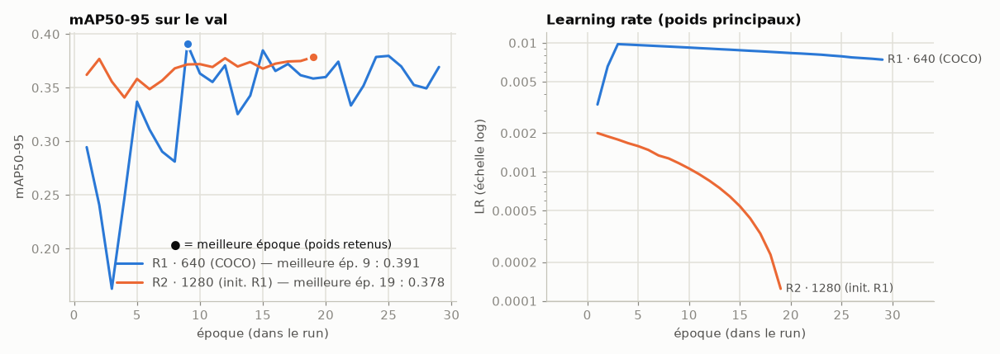

*Le val de R2 est mesuré à 1280, celui de R1 à 640 : les niveaux absolus ne se comparent pas
directement. R2 démarre des poids de l'époque 9 de R1.*

**R1 s'est arrêté avant d'avoir « refroidi ».** `optimizer=auto` a choisi MuSGD avec un LR
linéaire prévu sur 100 époques. L'arrêt précoce (patience 20, meilleure époque 9) a coupé le
run à l'époque 29, alors que le LR principal valait encore 0,0074 (contre 0,0098 au départ).
La mosaïque n'a jamais été désactivée. Le val oscille donc beaucoup d'une époque à l'autre
(mAP50-95 entre 0,33 et 0,39), et R1 est probablement sous-optimal. Un planning plus court
(`--epochs 30`) ou `--cos-lr` aurait laissé le LR décroître.

**R2 n'est pas un entraînement 1280 « from scratch COCO ».** C'est un **fine-tuning à 1280
initialisé depuis R1**, faute de temps : c'est un projet démo, et ce choix a été validé.
La comparaison 640 contre 1280 n'est donc pas « pure » :
- R2 a vu plus d'époques au total (R1 puis R2) ;
- son LR bas et décroissant fait aussi office de recuit, ce qui manquait à R1 ;
- il change d'optimiseur.
Le point de comparaison le plus honnête pour mesurer l'effet de la résolution seule est
**R1 évalué à 1280 en inférence**, sans réentraînement.

Choix du LR de R2. On part de poids déjà spécialisés drones ; on veut les adapter à la
nouvelle échelle sans les « oublier ». D'où :
- `lr0=0.002`, soit 5× moins que R1, avec décroissance linéaire ;
- un warmup court (1 époque) avec `warmup_bias_lr=0` : le défaut 0,1 secouerait des biais
  déjà réglés ;
- `close_mosaic=5`, pour garder la mosaïque sur l'essentiel d'un run court ;
- SGD classique explicite : `optimizer=auto` ignorerait `lr0` et choisirait MuSGD lr0 0,01
  (hybride Muon + SGD, nouveau dans Ultralytics 8.4). Pour un fine-tuning court on préfère un
  SGD standard au LR maîtrisé.

## Résultats sur le test

### Tableau comparatif (image entière, `model.val` Ultralytics)

| Modèle | imgsz inférence | SAHI | mAP50 | mAP50-95 | P | R | ms/image (bs1) | Matériel |
|---|---|---|---|---|---|---|---|---|
| run court v0 (5 ép.) | 640 | non | 0,626 | 0,251 | 0,764 | 0,609 | 7,6 | RTX 3070 Laptop |
| **R1** | 640 | non | 0,775 | **0,301** | 0,805 | 0,801 | 8,0 | RTX 3070 Laptop |
| R1, inférence à 1280 | 1280 | non | 0,669 | 0,238 | 0,645 | 0,607 | 9,8 | RTX 3070 Laptop |
| **R2** (fine-tuning 1280) | 1280 | non | **0,781** | 0,265 | 0,778 | **0,812** | 10,0 | RTX 3070 Laptop |
| R2, inférence à 640 | 640 | non | 0,761 † | 0,281 | 0,820 | 0,795 | 7,3 | RTX 3070 Laptop |

† Instable : 0,681 avec `model.predict`, comme en déploiement (voir Protocole).

Courbes précision-rappel sur le test :

| R1 à 640 | R2 à 1280 |
|---|---|
| 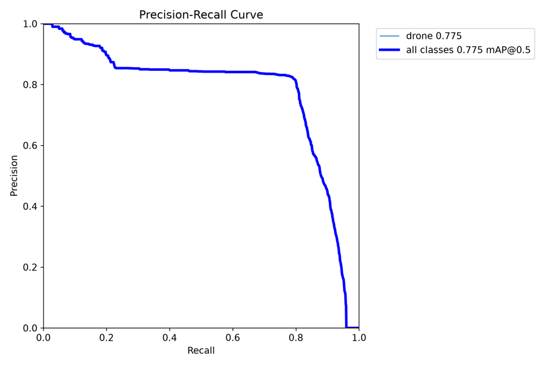 | 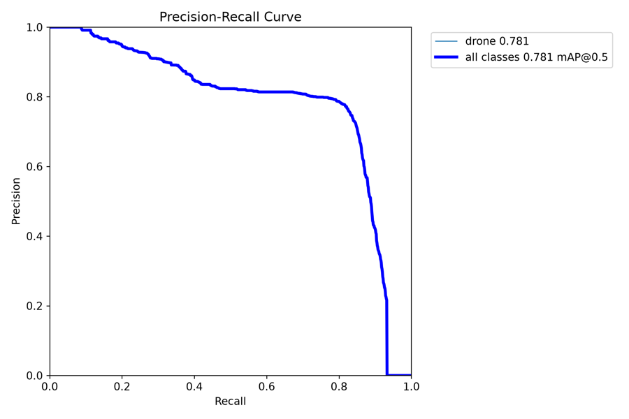 |

### SAHI : tuiles contre image entière (évaluateur commun, 2 326 images)

Tuiles de 640 px de l'image d'origine, recouvrement 0,2. La passe image entière est conservée,
et la fusion se fait par NMS à IoU 0,5. Une image 1080p donne 8 tuiles + 1 passe entière ;
une image 640×512 tient dans une seule tuile.

| Modèle | Mode (tuiles inférées à) | mAP50 | mAP50-95 | P | R | ms/image moyen | ms/image 1080p |
|---|---|---|---|---|---|---|---|
| R1 | image entière 640 | 0,759 | 0,300 | 0,798 | 0,788 | 22 | – |
| R1 | **SAHI 640 (@640)** | 0,769 | 0,300 | 0,791 | 0,819 | 45 | – |
| R2 | image entière 1280 | 0,766 | 0,261 | 0,788 | 0,803 | 14 | 19 |
| R2 | SAHI 640 (@640) | 0,652 | 0,229 | 0,649 | 0,753 | 26 | 57 |
| R2 | SAHI 640 (@1280) | 0,679 | 0,225 | 0,646 | 0,789 | 59 | 148 |

R1 a été mesuré sous charge CPU, R2 sur machine calme : les temps se comparent au sein d'un
même modèle. Le global masque des effets opposés selon la source, d'où le tableau suivant.

### Par source (évaluateur commun, `model.predict`)

| Modèle / mode | Halmstad mAP50 | Halmstad mAP50-95 | Halmstad R | DUT mAP50 | DUT mAP50-95 | DUT R |
|---|---|---|---|---|---|---|
| R1 @640 | 0,763 | **0,307** | 0,824 | 0,780 | 0,317 | 0,722 |
| R1 @1280 | 0,504 | 0,164 | 0,446 | 0,833 | 0,331 | 0,789 |
| R1 + SAHI 640 | 0,746 | 0,289 | 0,824 | 0,835 | **0,343** | 0,777 |
| **R2 @1280** | **0,784** | 0,296 | 0,813 | 0,819 | 0,270 | 0,788 |
| R2 @640 | 0,593 | 0,220 | 0,669 | 0,838 | 0,316 | 0,796 |
| **R2 + SAHI 640 (@640)** | 0,588 | 0,206 | 0,722 | **0,885** | 0,323 | **0,857** |
| R2 + SAHI 640 (@1280) | 0,743 | 0,265 | 0,808 | 0,803 | 0,267 | 0,783 |

- **Halmstad (640×512)** : le meilleur choix est R2 à 1280, avec l'image agrandie 2× comme à
  l'entraînement, ou R1 à 640. Inférer R2 à 640, en image entière comme en tuile unique,
  présente les drones 2× plus petits qu'à l'entraînement. SAHI n'apporte rien ici : il n'y a
  qu'une tuile, et sa NMS de fusion à IoU 0,5 retire parfois la boîte la mieux placée.
- **DUT (1920×1080)** : réduire l'image 3× (R1 à 640) écrase les petits drones. Mieux vaut
  R1 à 1280, SAHI, ou R2. **R2 + tuiles 640 à pleine résolution** est le meilleur résultat
  (0,885), au prix de 9 inférences par image.
- **Leçon** : la bonne taille d'inférence dépend de la résolution de la caméra. Il faut que
  la taille apparente des drones en pixels réseau reste proche de celle vue à l'entraînement.
  Pour la démo :
  - **R2 à 1280** pour un flux 640×512 ou 720p ;
  - **R2 à 1280, ou SAHI sur une région d'intérêt**, pour du 1080p.
- **Réserve DUT** : le test DUT ne compte que 3 séquences, et un risque résiduel de fuite depuis
  DUT détection existe (voir `DATA.md`). Les chiffres DUT sont donc à prendre avec prudence ;
  Halmstad n'est pas concerné.

### Rappel par taille de cible (évaluateur commun, conf. F1-optimale)

| Taille √(w·h) | < 16 px | 16–32 px | 32–96 px |
|---|---|---|---|
| Nb de drones (test) | 15 | 776 | 1 191 |
| R1 @640 — IoU 0,5 / IoU 0,3 | 0,00 / 0,80 | 0,78 / 0,93 | 0,80 / 0,90 |
| R1 @1280 — IoU 0,5 / IoU 0,3 | 0,73 / 0,87 | 0,46 / 0,78 | 0,64 / 0,71 |
| R2 @1280 — IoU 0,5 / IoU 0,3 | 0,00 / 0,53 | 0,75 / 0,92 | **0,88 / 0,97** |

Aucune cible du test ne dépasse 96 px. Les 15 cibles de moins de 16 px (toutes Halmstad)
sont souvent **trouvées**, mais avec une boîte 2× trop grande, d'où un IoU inférieur à 0,5.
Ce sont trop peu de cas pour conclure.

### Localisation : IoU 0,5 contre IoU 0,3 (évaluateur commun)

| Modèle | P / R / F1 @IoU 0,5 | P / R / F1 @IoU 0,3 | mAP75 |
|---|---|---|---|
| R1 @640 | 0,798 / 0,788 / 0,793 | 0,921 / 0,908 / 0,914 | 0,169 |
| R1 @1280 | 0,682 / 0,570 / 0,621 | 0,830 / 0,737 / 0,781 | 0,123 |
| **R2 @1280** | 0,771 / 0,821 / 0,795 | **0,905 / 0,951 / 0,927** | 0,112 |
| R2 @640 | 0,747 / 0,717 / 0,732 | 0,886 / 0,845 / 0,865 | 0,116 |

Le mAP75 est bas (0,11–0,17) : la détection est bonne, le cadrage précis ne l'est pas. Les
vérités terrain font 15–40 px, avec des conventions différentes selon la source :
- boîtes Halmstad parfois lâches autour d'un drone lointain (cf. `DATA.md`), parfois serrées ;
- boîtes DUT souvent plus larges que le drone.

Le modèle apprend un compromis, et 2–3 px d'écart suffisent à passer sous IoU 0,5 sur une
cible de 20 px. R2 détecte plus (rappel 0,95 à IoU 0,3) mais cadre moins bien que R1
(mAP50-95 0,265 contre 0,301). Pour la visée, qui utilise le centre de la boîte, ce défaut de
cadrage pèse peu.

## Galerie d'échecs (R2 à 1280, seuil 0,36)

Générée par `scripts/failures.py` : 32 vignettes dans
[`assets/failures/`](assets/failures/), indexées dans `index.csv`. À gauche l'image entière
(zone zoomée en jaune), à droite le zoom. Vérité terrain en **vert**, prédictions en **rouge**
avec leur score. Les catégories des noms de fichiers sont des heuristiques automatiques
(luminance, texture, taille). Les légendes ci-dessous viennent de l'inspection visuelle des
images et corrigent l'heuristique quand elle se trompe.

Au seuil F1-optimal, R2 fait **355 FN et 485 FP** sur 1 982 drones :
- **283 FN et 348 FP sont des cibles trouvées mais mal cadrées** (IoU entre 0,1 et 0,5).
  C'est le même drone compté deux fois, une fois en FN et une fois en FP.
- Restent **72 drones réellement manqués** et **137 vrais FP**, dont 109 sur un même élément
  fixe d'une séquence.

**Cible trouvée, mais « fausse » à IoU 0,5**

| | |
|---|---|
| 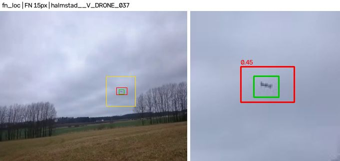 | Drone de 15 px sous ciel couvert, détecté (0,45), mais boîte prédite 2× plus grande que la vérité. Compte comme 1 FN + 1 FP. |
| 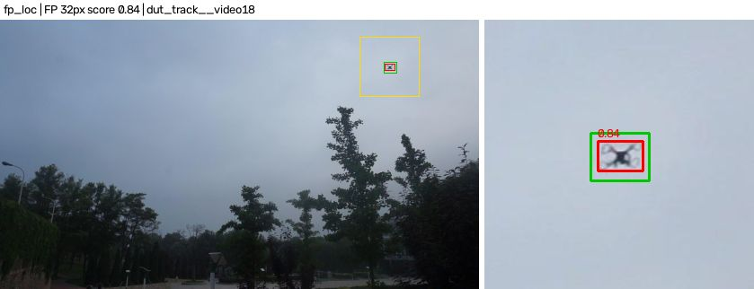 | Cas inverse sur DUT : drone détecté (0,84), boîte prédite serrée, vérité plus large. IoU 0,44. |

**Drones manqués**

| | |
|---|---|
| 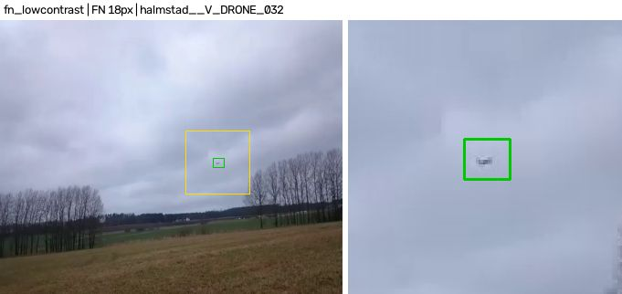 | Drone de 18 px très pâle devant des nuages gris : faible contraste. |
| 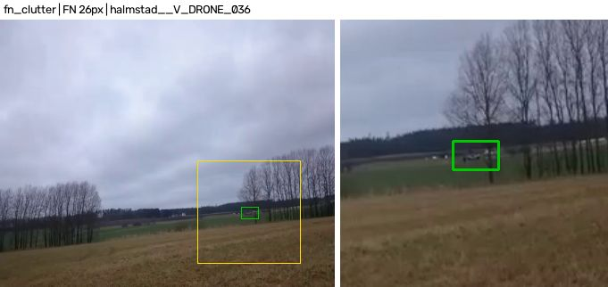 | Drone sous la ligne d'horizon, devant les arbres et le champ : fond texturé. Le modèle a surtout vu des drones sur fond de ciel. |
| 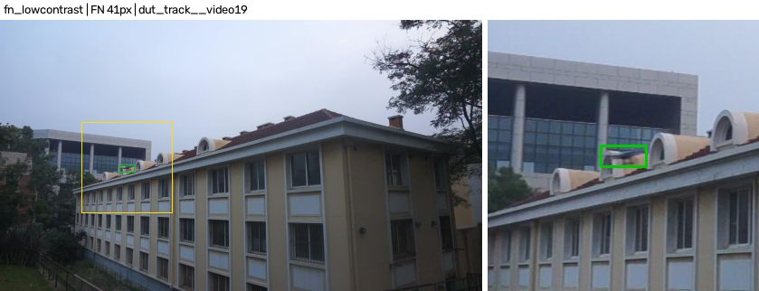 | Drone de 41 px devant un toit et des fenêtres : fond complexe, faible contraste. |
| 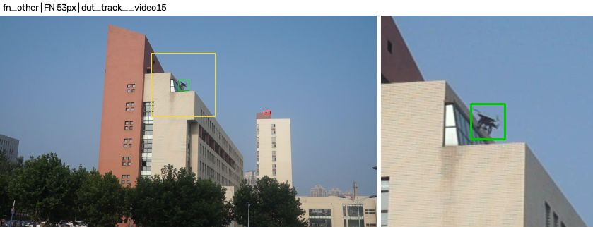 | Drone en partie masqué par l'angle d'un bâtiment (occultation partielle). |

**Faux positifs**

| | |
|---|---|
| 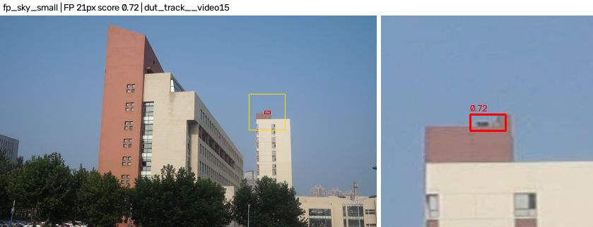 | **Élément fixe sur un toit** pris pour un drone (0,72). Il revient dans **109 images** de la séquence : c'est l'essentiel des vrais FP de R2. Comme il est statique, un suivi avec contrôle du mouvement l'éliminerait. Le verrouillage de la démo y est exposé. |
| 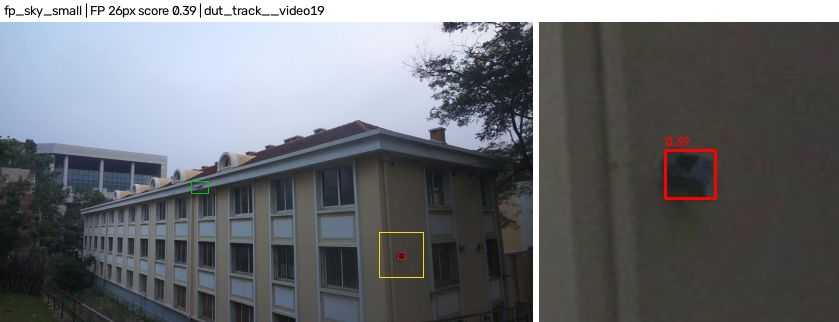 | Fenêtre sombre sur une façade (0,39). L'heuristique la range en « ciel », à tort. |
| 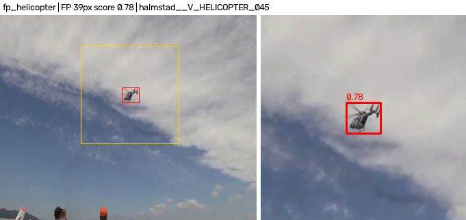 | Hélicoptère sur fond de nuages (0,78) : distracteur réel. |
| 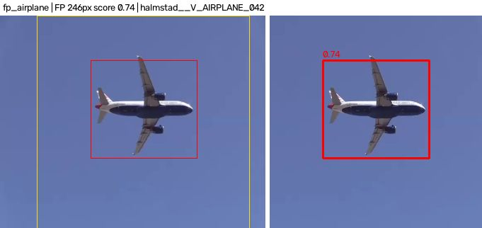 | Avion de ligne proche, 246 px (0,74). Aucun objet de cette taille dans les drones d'entraînement. |
| 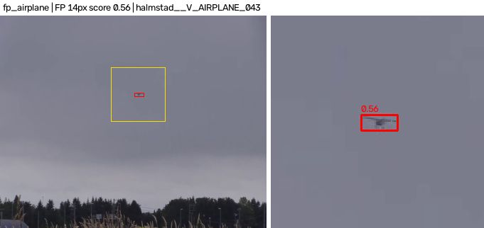 | Avion lointain de 14 px (0,56). À cette taille, il est indiscernable d'un drone. |
| 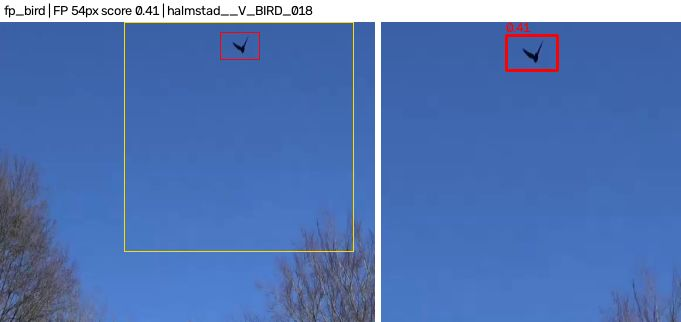 | Oiseau en vol, 54 px (0,41) : l'un des 2 seuls FP de R2 sur les 55 images d'oiseaux du test. |
| 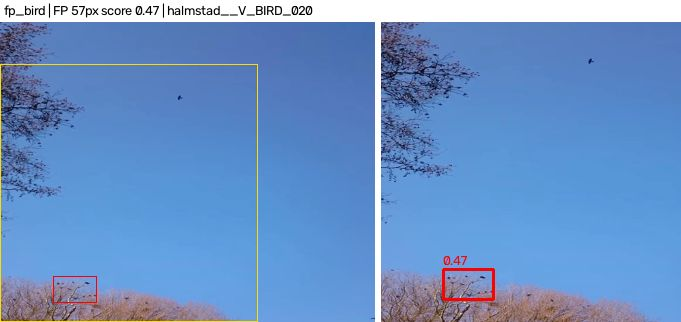 | Branches d'arbre en fleurs (0,47) dans une séquence d'oiseaux. Ce FP n'est **pas** l'oiseau, qui est le petit point plus haut. |
| 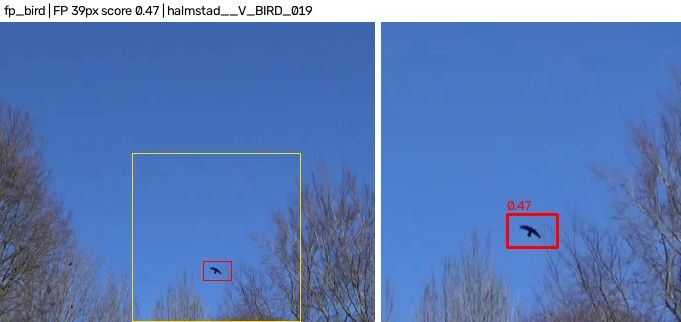 | **Pour comparaison, R1 à 640** : oiseau pris pour un drone (0,47). R1 fait **52 FP sur 55 images d'oiseaux** ; R2 n'en fait que 2, sans doute grâce aux détails visibles à 1280. |

Aucun contre-jour franc ne figure parmi les erreurs de R2. Le test contient peu de scènes face
au soleil : c'est un cas non évalué, pas un cas réussi.

## Analyse

1. **La chaîne marche de bout en bout, avec un modèle utile** : environ 95 % des drones du
   test sont localisés à IoU 0,3, avec une précision d'environ 0,9 et 10 ms par image sur un
   GPU portable. Les chiffres à IoU 0,5 et le mAP50-95 sont plus bas, surtout à cause de la
   précision des boîtes sur des cibles de 15–40 px aux annotations hétérogènes.
2. **L'échelle prime sur le modèle.** Le même réseau perd jusqu'à 26 points de mAP50 quand
   l'échelle d'inférence ne correspond pas à celle de l'entraînement. Pour un intercepteur, la
   résolution de la caméra fixe la taille d'inférence ; il faut entraîner à cette échelle.
3. **640 contre 1280.** À échelle adaptée, R2 à 1280 détecte un peu plus que R1 à 640 :
   - rappel 0,81 contre 0,80 à IoU 0,5, et 0,95 contre 0,91 à IoU 0,3 ;
   - beaucoup moins de confusions avec les oiseaux.
   Il cadre en revanche moins bien et coûte 25 % de latence en plus. Cet écart mélange l'effet
   de la résolution et celui d'un second entraînement à LR décroissant (voir Runs). Un
   contrôle « R1 réentraîné à 640 avec la même recette » permettrait de les séparer : non
   fait, faute de temps.
4. **SAHI** n'est rentable que sur les images haute résolution : +6 à +7,5 points de mAP50
   sur DUT, pour un temps ×3 sur ces images. Avec des tuiles inférées à 1280, le temps est ×8,
   sans gain. Pour du temps réel, une alternative est de découper
   en tuiles seulement une région d'intérêt autour de la cible verrouillée.
5. **Faux positifs restants** : aéronefs (avions, hélicoptères), objets fixes en hauteur
   (éléments de toit, fenêtres sombres), quelques oiseaux et branches. Le suivi temporel de la
   démo réduit les FP fugaces, mais pas les objets fixes. Un filtre de mouvement apparent ou un
   minimum de déplacement avant verrouillage serait la prochaine étape.

## Limites

- **Évaluation** :
  - un seul jeu de test, 49 séquences dont 3 DUT ;
  - les 15 cibles de moins de 16 px et les 55 images d'oiseaux sont trop peu nombreuses pour
    des conclusions fermes ;
  - pas de contre-jour, de nuit ni d'infrarouge.
- **Entraînement** : R1 s'est arrêté avant décroissance du LR. R2 est un fine-tuning de R1. Un
  seul seed, pas d'intervalle de confiance.
- **Annotations** : les conventions de boîtes diffèrent entre sources, ce qui pénalise le
  mAP50-95 et rend l'IoU 0,5 sévère sur les petites cibles.
- **Latences** : PyTorch FP32 sur GPU portable, très sensibles à la charge CPU. Les chiffres
  embarqués (Jetson, TensorRT) restent à mesurer.

## Reproduire

```bash
export YOLO_CONFIG_DIR=$PWD/.ultralytics
# R1 : 640 depuis COCO
.venv/bin/python scripts/train.py --data configs/drones.yaml --model yolo11n.pt --imgsz 640 \
    --epochs 100 --patience 20 --time 3 --batch 32 --name r1_y11n_640
# R2 : fine-tuning 1280 depuis R1
.venv/bin/python scripts/train.py --data configs/drones.yaml --model runs/train/r1_y11n_640/weights/best.pt \
    --imgsz 1280 --epochs 100 --patience 10 --time 2 --batch 12 --name r2_y11n_1280_ft \
    --optimizer SGD --lr0 0.002 --close-mosaic 5 --set warmup_epochs=1 --set warmup_bias_lr=0.0
# Évaluations sur le test (→ runs/eval/<run>_<imgsz>_test/)
for w in r1_y11n_640 r2_y11n_1280_ft; do for s in 640 1280; do
    .venv/bin/python scripts/eval.py --weights runs/train/$w/weights/best.pt --imgsz $s; done; done
# SAHI (→ runs/sahi/…)
.venv/bin/python scripts/sahi_eval.py --weights runs/train/r1_y11n_640/weights/best.pt --imgsz 640 --slice 640
.venv/bin/python scripts/sahi_eval.py --weights runs/train/r2_y11n_1280_ft/weights/best.pt --imgsz 1280 \
    --slice 640 --slice-imgsz 640 --name r2_y11n_1280_ft_1280_s640at640_test
.venv/bin/python scripts/sahi_eval.py --weights runs/train/r2_y11n_1280_ft/weights/best.pt --imgsz 1280 \
    --slice 640 --slice-imgsz 1280 --name r2_y11n_1280_ft_1280_s640at1280_test
# Galerie d'échecs (R2, seuil F1-optimal) + figure des courbes
.venv/bin/python scripts/failures.py --preds runs/eval/r2_y11n_1280_ft_1280_test/predictions.json \
    --conf 0.36 --per-category 4 --clean
.venv/bin/python scripts/plot_training.py --runs r1_y11n_640:"R1 · 640 (COCO)" \
    r2_y11n_1280_ft:"R2 · 1280 (init. R1)" --out docs/assets/training_curves.png
```

L'exemple « R1 oiseau » de la galerie vient de
`failures.py --preds runs/eval/r1_y11n_640_640_test/predictions.json --conf 0.39`, généré
dans `runs/`, puis copié sous le préfixe `r1__`.
